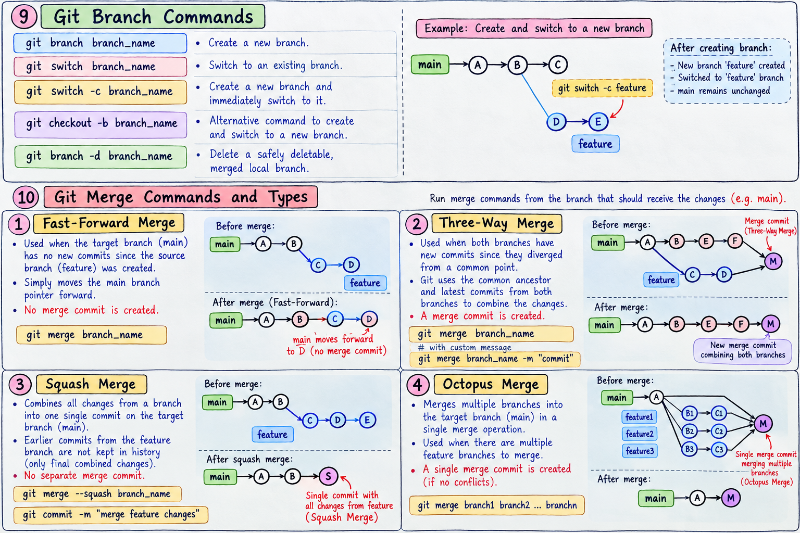

# Git and Linux Commands – Notes

## Table of Contents

| Section | Content |
|---|---|
| 1 | File and Directory Commands |
| 2 | Git History and File Changes |
| 3 | Tracking Empty Directories |
| 4 | The Three Main Areas in Git |
| 5 | Git Restore and Unstaging |
| 6 | Git Reset Commands |
| 7 | Quick Comparison: Git Reset |
| 8 | Git Revert |
| 9 | Git Branch Commands |
| 10 | Git Merge Commands and Types |

---

## 1. File and Directory Commands

### 1.1 Basic Commands

| Command | Explanation |
|---|---|
| `echo "hello" > file.txt` | Creates a file or overwrites its existing content. |
| `cat file.txt` | Displays file contents. |
| `echo "hello1" >> file.txt` | Appends content to a file. |
| `ls -a` | Lists all files, including hidden files. |
| `rm -rf *` | Deletes non-hidden files and directories in the current directory, including nested contents. |

### 1.2 Understanding Command Components

| Component | Meaning |
|---|---|
| `echo` | Prints text or sends it to a file. |
| `>` | Overwrites file content. |
| `>>` | Appends content to a file. |
| `cat` | Displays file contents. |
| `ls` | Lists directory contents. |
| `-a` | Includes hidden entries. |
| `rm` | Removes files or directories. |
| `-r` | Removes directories recursively. |
| `-f` | Forces removal without normal confirmation prompts. |
| `*` | Matches non-hidden names in the current directory. |

**Warning:** `rm -rf *` is destructive and does not normally delete hidden entries such as `.git`.

---

## 2. Git History and File Changes

### 2.1 Viewing Commit History

| Command | Purpose |
|---|---|
| `git log` | Displays detailed commit history. |
| `git log --oneline` | Displays compact commit history. |

### 2.2 Viewing File Changes

| Command | Purpose |
|---|---|
| `git diff` | Shows unstaged changes between the working directory and staging area. |

---

## 3. Tracking Empty Directories

### 3.1 What Is `.gitkeep`?

Git does not track empty directories by default. A common convention is to add a `.gitkeep` file to an otherwise empty directory.

### 3.2 Example Folder Structure

```text
project/
├── src/
│   └── .gitkeep
└── README.md
```

**Note:** `.gitkeep` is not a special Git command or feature. It is a conventionally named placeholder file.

---

## 4. The Three Main Areas in Git

### 4.1 Working Directory (WD)

The location where you create, modify, or delete files.

```bash
git add filename
```

This stages the selected changes.

### 4.2 Staging Area (SA)

Contains changes selected for the next commit.

```bash
git commit -m "message"
```

### 4.3 Local Repository (Repo)

Stores committed snapshots and project history.

**Workflow:**

```text
Working Directory
       |
    git add
       v
  Staging Area
       |
   git commit
       v
 Local Repository
```

---

## 5. Git Restore and Unstaging

### 5.1 Discard Unstaged Changes

```bash
git restore filename
```

Restores the file to its staged version, or its last committed version if no staged version exists.

### 5.2 Unstage a File

```bash
git restore --staged filename
```

Removes the file from the staging area without discarding its working-directory changes.

---

## 6. Git Reset Commands

`git reset` moves the current branch reference to an earlier commit. Its effect on the staging area and working directory depends on the option used.

### 6.1 Soft Reset

**Command:**

```bash
git reset --soft HEAD~1
```

- Moves the current branch back by one commit.
- Keeps the changes staged.
- Does not discard the changes.

You can use `HEAD~2` to move back two commits.

**To unstage the changes:**

```bash
git restore --staged filename
```

The changes remain in the working directory.

### 6.2 Mixed Reset (Default)

**Command:**

```bash
git reset HEAD~1
```

Equivalent to:

```bash
git reset --mixed HEAD~1
```

- Moves the current branch back by one commit.
- Resets the staging area.
- Keeps the changes in the working directory as unstaged changes.

You can stage the changes again:

```bash
git add filename
```

To discard unstaged changes to a file:

```bash
git restore filename
```

### 6.3 Hard Reset

**Command:**

```bash
git reset --hard HEAD~1
```

- Moves the current branch back by one commit.
- Resets the staging area.
- Resets tracked working-directory files to match the target commit.

**Warning:** Uncommitted changes to tracked files can be permanently lost. Untracked files and directories are not normally deleted by `git reset --hard`.

---

## 7. Quick Comparison: Git Reset

### 7.1 Soft vs. Mixed vs. Hard Reset

| Feature | `--soft` | `--mixed` (Default) | `--hard` |
|---|---|---|---|
| Moves branch to an earlier commit | Yes | Yes | Yes |
| Resets staging area | No | Yes | Yes |
| Resets tracked working files | No | No | Yes |
| Changes remain staged | Yes | No | No |
| Changes remain in working directory | Yes | Yes | No, tracked files are reset |
| Risk of losing uncommitted changes | Low | Low | High |

**Remember:**

- `--soft` → Changes remain staged.
- `--mixed` → Changes remain unstaged.
- `--hard` → Tracked files are reset; uncommitted changes may be lost.

---

## 8. Git Revert

- **`git revert commit_id`** – Creates a new commit that reverses the changes introduced by the specified commit. The original commit and other commits stay in history. Use this command to undo a commit that has already been pushed to a GitHub repository.

## 9. Git Branch Commands



- **`git branch branch_name`** – Creates a new branch.
- **`git switch branch_name`** – Switches to an existing branch.
- **`git switch -c branch_name`** – Creates a new branch and immediately switches to it.
- **`git checkout -b branch_name`** – Alternative command to create and switch to a new branch.
- **`git branch -d branch_name`** – Deletes a safely deletable, merged local branch.

---

## 10. Git Merge Commands and Types

**`git merge branch_name`** – Merges the specified branch into the currently checked-out branch.

### 10.1 Fast-Forward Merge

**Command:**

```bash
git merge branch_name
```

**Meaning:** Moves the current branch pointer forward when it has no new commits that diverge from the feature branch.

### 10.2 Three-Way Merge

**Command:**

```bash
git merge branch_name
```

**Meaning:** Combines changes when both branches have diverged from their common ancestor. Git normally creates a merge commit automatically.

To provide a message for the merge commit:

```bash
git merge branch_name -m "merge feature branch"
```

**Note:** `-m` specifies the merge commit message; it does not itself enable three-way merging.

### 10.3 Squash Merge

**Command:**

```bash
git merge --squash branch_name
git commit -m "merge feature changes"
```

**Meaning:** Combines the net changes from the feature branch into one staged change on the current branch. The second command creates the single commit.

### 10.4 Octopus Merge

**Command:**

```bash
git merge branch_name1 branch_name2 ... branch_namen
```

**Meaning:** Merges multiple branches into the current branch in one operation, usually when their changes can be combined without conflicts.

**Remember:** Run merge commands from the branch that should receive the changes, such as `main`.
